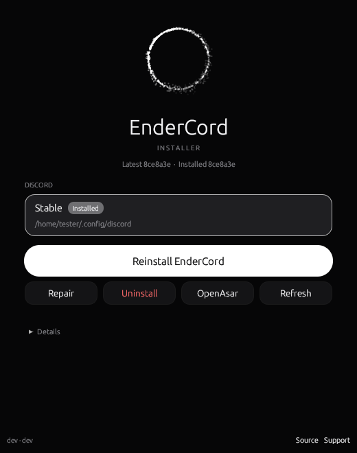

<p align="center">
  
</p>

<p align="center">
  <a href="https://github.com/EnderMythex/EndercordInstaller/releases/latest"></a>
  <a href="https://github.com/EnderMythex/EndercordInstaller/releases"></a>
  
  <a href="LICENSE"></a>
</p>

<p align="center">
  The installer for <a href="https://github.com/EnderMythex/Endercord"><b>EnderCord</b></a>. One click to install, repair or remove it,<br>
  native and fast, for Windows, macOS and Linux.
</p>

<br>

<table>
  <tr>
    <td width="45%" valign="top"></td>
    <td width="55%" valign="top">

### Download

| | GUI | CLI |
| --- | --- | --- |
| **Windows** | [x64](https://github.com/EnderMythex/EndercordInstaller/releases/latest/download/EndercordInstaller.exe) · [ARM64](https://github.com/EnderMythex/EndercordInstaller/releases/latest/download/EndercordInstaller-arm64.exe) | [x64](https://github.com/EnderMythex/EndercordInstaller/releases/latest/download/EndercordInstallerCli.exe) · [ARM64](https://github.com/EnderMythex/EndercordInstaller/releases/latest/download/EndercordInstallerCli-arm64.exe) |
| **macOS** | [Universal](https://github.com/EnderMythex/EndercordInstaller/releases/latest/download/EndercordInstaller-macos.zip) | [Universal](https://github.com/EnderMythex/EndercordInstaller/releases/latest/download/EndercordInstallerCli-universal) |
| **Linux** | [x64](https://github.com/EnderMythex/EndercordInstaller/releases/latest/download/EndercordInstaller-linux) · [ARM64](https://github.com/EnderMythex/EndercordInstaller/releases/latest/download/EndercordInstaller-linux-arm64) | [x64](https://github.com/EnderMythex/EndercordInstaller/releases/latest/download/EndercordInstallerCli-linux) · [ARM64](https://github.com/EnderMythex/EndercordInstaller/releases/latest/download/EndercordInstallerCli-linux-arm64) |

On macOS the app isn't notarized: right click it and choose **Open** the first time. On Linux and macOS, run `chmod +x <file>` on the CLI after downloading.

Or in one line, on Linux:

```sh
sh -c "$(curl -sS https://raw.githubusercontent.com/EnderMythex/EndercordInstaller/main/install.sh)"
```

On Windows, from PowerShell:

```powershell
iwr -useb https://raw.githubusercontent.com/EnderMythex/EndercordInstaller/main/install.ps1 | iex
```

  </td>
  </tr>
</table>

<br>

## What it does

- **Finds every Discord** you have: Stable, PTB and Canary, including Flatpak and distro packages on Linux.
- **Installs, repairs and uninstalls** EnderCord in one click, and never leaves Discord half patched: if a step fails, everything is put back.
- **Keeps you logged in.** If Discord is open, it asks you to quit it from the tray first, since force closing Discord logs you out. Force closing stays available if you want it.
- **Starts Discord again** once it's done.
- **Handles Discord updates.** EnderCord re-patches new Discord versions itself, and the installer recognises those installs for repair and uninstall.
- **Adds or removes [OpenAsar](https://github.com/GooseMod/OpenAsar)**, which makes Discord start faster.
- **Updates itself** when a new version is released.

<br>

## Command line

Run it without arguments for an interactive menu, or:

```sh
EndercordInstallerCli --install   [--branch auto|stable|ptb|canary] [--location <path>]
EndercordInstallerCli --repair    # download the latest EnderCord and reinstall
EndercordInstallerCli --uninstall
EndercordInstallerCli --install-openasar | --uninstall-openasar
EndercordInstallerCli --update-self | --version | --debug
```

`pnpm inject` in the EnderCord repository uses this CLI to point Discord at your local build.

<br>

## Build

Install [Rust](https://rustup.rs), then:

```sh
cargo build --release                        # GUI
cargo build --release --no-default-features  # CLI
```

On Linux the GUI needs `libxkbcommon-dev libwayland-dev libgl1-mesa-dev` to build.

Releases are built by GitHub Actions for every platform when a tag starting with `v` is pushed:

```sh
git tag v1.0.6 && git push origin v1.0.6
```

<br>

## Credits

Based on the [Vencord Installer](https://github.com/Vencord/Installer) by Vendicated and contributors, and its [Equicord](https://github.com/Equicord) and [PawsomeVencord](https://github.com/enzomtpYT/PawsomeVencord) forks, rewritten in Rust. Licensed under the [GPL 3.0](LICENSE).
